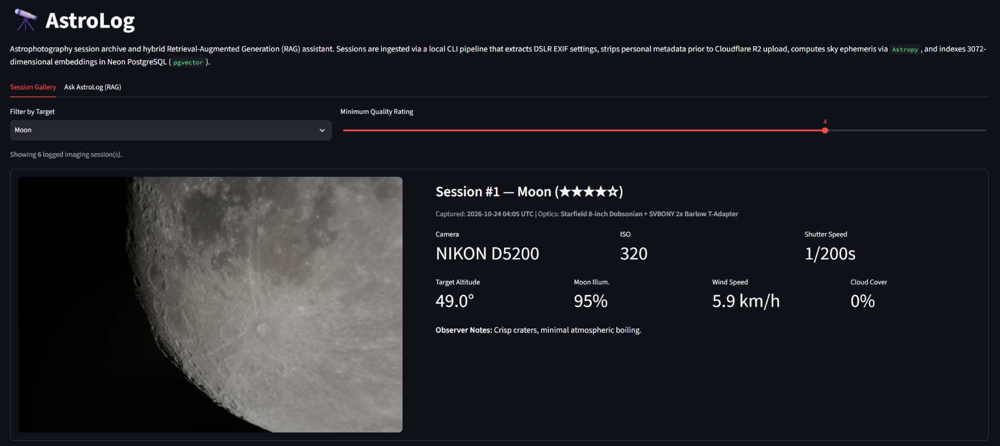
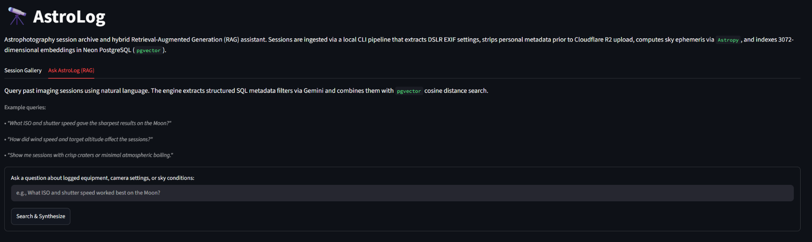

            

# AstroLog

A web app and Retrieval-Augmented Generation (RAG) assistant for logging and querying my telescope photography sessions. When I upload a photo locally through the CLI script, the pipeline pulls the camera settings from the image, calculates where the target was in the sky, fetches the historical weather for that hour, and stores everything in Postgres alongside a vector embedding. The public Streamlit app is read-only: visitors can browse the photo gallery or use the RAG assistant to ask an LLM natural-language questions grounded in my logged sessions.

**Live demo:** [astro-log.streamlit.app/](https://astro-log.streamlit.app/)





## How it works

The project is split into two parts so the public web app doesn't expose any upload routes or write credentials:

### 1. Local Upload Script (`ingest.py`)
After taking photos through my telescope, I run `ingest.py` locally with the image path, target name, a 1–5 rating, and my notes. The script:
1. **Reads camera EXIF data** — Extracts the timestamp, camera model, ISO, and shutter speed from the JPEG using Pillow, and converts the camera's local timestamp to UTC.
2. **Strips metadata and uploads the image** — Applies the EXIF orientation tag directly to the pixels so portrait shots don't rotate, then re-saves the raw image into an in-memory buffer with all EXIF tags (serial numbers, device metadata, etc.) removed before uploading it to Cloudflare R2 via `boto3`.
3. **Pulls sky and weather data** — Uses `Astropy` (with the capture timestamp and my local coordinates from `.env`) to calculate the target's altitude, azimuth, and the Moon's illumination percentage. It then queries the Open-Meteo API for the cloud cover, wind speed, and temperature at that hour.
4. **Embeds and stores the session** — Combines all the settings, weather data, and notes into a text summary, generates a 3072-dimension vector embedding using `gemini-embedding-001`, and inserts the row into a Neon PostgreSQL database (`pgvector`).

### 2. Public Web App & Search (`app.py`)
The Streamlit app connects to the database in read-only mode and has two views:
- **Gallery** — Displays all logged sessions with filters for target name and minimum rating, rendering the stripped images from Cloudflare R2 alongside the camera and sky stats.
- **RAG Search** — Lets users ask natural-language questions about the logged sessions (e.g., *"What ISO and shutter speed gave the sharpest shots of the Moon when wind was low?"*).

## Why hybrid search instead of pure vector search

Pure vector similarity is good at matching wording and concepts (like matching *"blurry craters"* in a question to *"atmospheric boiling"* in my notes), but it is bad at evaluating number ranges like `wind_speed_kmh <= 15` or `rating >= 4`. To an embedding model, `"Wind Speed: 30 km/h"` and `"wind under 15 km/h"` look very similar because both phrases are talking about wind speed in km/h.

To fix this, `core/rag.py` runs a two-step hybrid search when a question is submitted:
1. **Filter extraction** — Sends the question to Gemini (`gemini-3.6-flash`) with a Pydantic schema to extract any explicit SQL filters (target name, minimum rating, max wind speed, max cloud cover).
2. **SQL + vector query** — Runs a single Postgres query that filters the rows using standard SQL `WHERE` clauses first, then ranks the matching sessions by `pgvector` cosine distance (`<=>`). If the SQL filters are too strict and match zero rows, it falls back to a standard vector search so the user still gets the closest results.

Finally, the top matching rows are passed back to Gemini to generate an answer that cites the specific session IDs and dates.

## Tech stack

| | |
|---|---|
| **Frontend** | Streamlit |
| **Database** | PostgreSQL ([Neon](https://neon.tech)), `pgvector`, SQLAlchemy, `psycopg` v3 |
| **Image Storage** | [Cloudflare R2](https://developers.cloudflare.com/r2/) (`boto3` S3 client) |
| **AI / RAG** | Google GenAI SDK (`gemini-3.6-flash`, `gemini-embedding-001`), Pydantic |
| **Image & Sky Data** | Pillow, Astropy, HTTPX (Open-Meteo API) |
| **Testing & CI** | pytest, GitHub Actions |

## Project structure

```
astro-log/
├── core/
│   ├── config.py          # Loads .env settings via pydantic-settings
│   ├── database.py        # SQLAlchemy engine and pgvector table setup
│   ├── models.py          # ImagingSession database model
│   └── rag.py             # Embeddings, SQL filter extraction, hybrid search, and answer generation
├── ingestion/
│   ├── exif.py            # EXIF extraction and in-memory metadata stripping
│   ├── enrichment.py      # Astropy sky calculations and Open-Meteo weather fetching
│   └── storage.py         # Cloudflare R2 image upload
├── tests/
│   ├── test_exif.py       # Tests for EXIF parsing and metadata removal
│   └── test_enrichment.py # Tests for Astropy calculations and text formatting
├── ingest.py              # CLI script for logging new sessions locally
└── app.py                 # Streamlit web app
```

## Running locally

**Prerequisites:** Python 3.11+, a PostgreSQL database with `pgvector` (e.g., [Neon](https://neon.tech)), a [Cloudflare R2](https://developers.cloudflare.com/r2/) bucket (only needed if running `ingest.py`), and a Gemini API key.

```bash
git clone https://github.com/adedhi/astro-log.git
cd astro-log
python -m venv .venv
.\.venv\Scripts\activate  # On macOS/Linux: source .venv/bin/activate
pip install -r requirements.txt
```

Create a `.env` file in the root directory (see `.env.example`):

```ini
DATABASE_URL="postgresql://..."
GEMINI_API_KEY="your_gemini_api_key"

# Only needed locally for ingest.py
R2_ENDPOINT_URL="https://<account_id>.r2.cloudflarestorage.com"
R2_ACCESS_KEY_ID="your_r2_access_key_id"
R2_SECRET_ACCESS_KEY="your_r2_secret_access_key"
R2_BUCKET_NAME="astrolog-images"
R2_PUBLIC_URL="https://pub-xxxxxxxxxxxx.r2.dev"

OBSERVER_LATITUDE="43.5890"
OBSERVER_LONGITUDE="-79.6441"
OBSERVER_ELEVATION_M="115.0"
OBSERVER_TIMEZONE="America/Toronto"
```

Initialize the database table and log a photo:

```bash
python -m core.database
python ingest.py path/to/DSC_0001.JPG --target "Moon" --rating 4 --notes "Crisp craters, minimal atmospheric boiling."
```

Run the Streamlit app:

```bash
streamlit run app.py
```

## Testing

The unit tests check EXIF extraction, timezone conversion, EXIF removal, Astropy coordinate ranges, and RAG document formatting offline without hitting the database or external APIs:

```bash
pytest
```

## License

